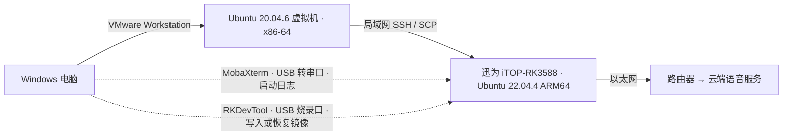
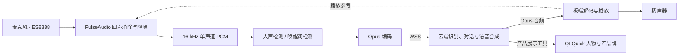

# 小哒 · Xiaoda

我叫 Steven.Xia（[@atainiss1](https://github.com/atainiss1)），在 Khadas 担任软件工程师。小哒是我以个人身份开发和维护的项目。

小哒是我做的第一个嵌入式 AI 项目：一台能听、能说、能用手势回应人的 Linux 桌面伙伴。它运行在配备 7 英寸触摸屏的迅为 iTOP-RK3588 商业级连接器版开发板上。你可以叫一声「你好小哒」，聊聊今天的天气，也可以让它拉出产品牌，用中文或英文介绍一块开发板。

  
  &nbsp;&nbsp;
  

## 这套演示用了什么硬件

| 部件 | 实机选型 | 在小哒里做什么 |
| --- | --- | --- |
| 开发板 | 北京迅为 **iTOP-RK3588 商业级连接器版**，8 GB RAM + 64 GB eMMC | 运行 Ubuntu 22.04.4 ARM64、语音服务和 Qt Quick 界面。实机设备树报告 `TOPEET iTOP-RK3588 Standard Board`。 |
| 显示与触摸 | 迅为配套 **7 英寸 MIPI 触摸屏**，实机显示为 **800 × 1280** 竖屏 | 显示人物、字幕和产品牌，接收触摸操作。 |
| 收音 | **纽曼 ZM01 电脑麦克风** | 桌面麦克风采集说话声，板载 **ES8388** 通过主麦克风输入送入 Linux 音频系统。 |
| 放音 | **惠普 S01 蓝牙音响** | 播放小哒的回答。项目启动脚本选用 ES8388 模拟播放设备，详见[板端音频脚本](scripts/run-board.sh)。 |
| 散热 | 迅为 **iTOP-RK3588 连接器版 V2.0 专用散热风扇** | 给开发板散热；[风扇温控工具](tools/rk3588-fan-quiet/)单独维护。 |
| 联网 | 开发板以太网口接路由器 | 虚拟机通过局域网部署程序，开发板通过路由器访问云端语音服务。 |

购买套装还包含 **IMX415 摄像头**和 **4G 模块**。这版演示使用麦克风、触摸屏和以太网，复现语音对话与产品展示无需接入这两件配件。

## 我是怎样开发和上板的

我在 Windows 上启动 VMware，在 Ubuntu 虚拟机里用 VS Code 写 C++ 和 QML。改动先在虚拟机用 CMake、CTest 做本机验证，再用 Arm GNU 10.3 交叉编译板端程序。用 SCP 把程序或改过的素材传到开发板，用 SSH 启动程序、读取日志，最后对着真麦克风说话、听音响回复并检查触摸动作。平时迭代走网络；需要看早期启动日志时用串口，更新系统镜像时才用烧录口。[按步骤构建与部署](docs/BUILD.md)

## 和小哒聊一轮

| 你做什么 | 屏幕上和扬声器里会发生什么 |
| --- | --- |
| 叫「你好小哒」或点击开始 | 进入语音对话。小哒回答时，再叫唤醒词可以打断播放。 |
| 说「用英文介绍 Edge2」 | 小哒调出产品牌，进入讲解姿势，并按当前语言约定回答。也可要求中英双语。 |
| 说「收起来」 | 云端识别意图并请求收牌，板端收起界面，语音会话继续。 |
| 轻触人物或停下来休息 | 触摸触发动作。待机约 15 秒后，小哒闭眼休息。 |

天气依赖已配置的云端实时查询能力。产品介绍使用设备上的产品目录，图片来源和整理记录随目录保存在 `data/`。

## 一句话怎样变成回答

板端使用 sherpa-onnx 运行 Silero VAD 和关键词模型，完成主语音链的人声检测与唤醒。旧版 VAD 和部分诊断测试使用源自 WebRTC 的 libfvad。音频设备按 48 kHz 工作，语音算法处理 16 kHz 单声道。口型、触摸反馈和产品牌都在本机绘制。

## 从哪里开始

- **第一次编译**：先在 Ubuntu 上跑本机测试，无需连接开发板或登录云端。见[构建与运行](docs/BUILD.md)。
- **改人物和产品牌**：从 `ui/XiaodaCharacter.qml`、`ui/ProductBoard.qml` 和 `data/khadas-products.json` 开始。
- **改语音交互**：`src/speech_engine.hpp` 处理检测，`src/cloud_main.cpp` 负责云端连接，`src/product_mcp.hpp` 实现展示工具。
- **查依赖和素材来源**：见[第三方组件与素材](THIRD_PARTY.md)。

云端语音使用小智协议，需要自己的已绑定设备身份。产品照片、品牌标志及第三方组件的来源单独列出。
