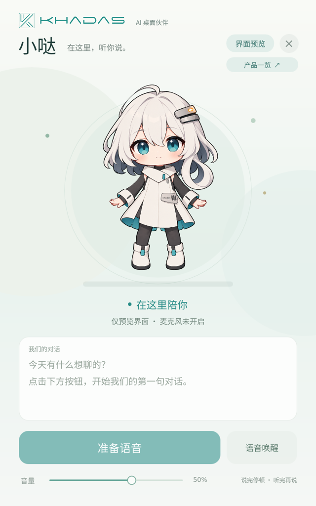
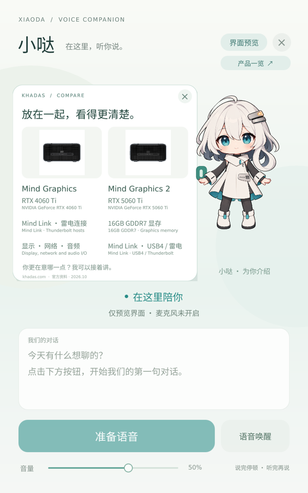
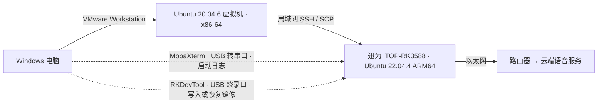
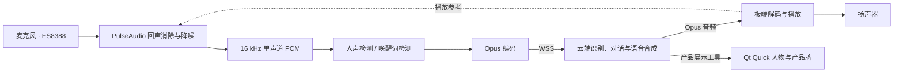

# 小哒 · Xiaoda

小哒是运行在迅为 iTOP-RK3588 上的桌面语音伙伴，支持中英文对话和天气查询。说「介绍一下 Khadas 的产品」，小哒会在屏幕上展开产品牌，并用语音讲解。

这是 Khadas 软件工程师 [Steven.Xia（@atainiss1）](https://github.com/atainiss1) 以个人身份开发和维护的首个嵌入式 AI 项目。

  
  &nbsp;&nbsp;
  

## 硬件选型

| 部件 | 型号与配置 | 实机用途 |
| --- | --- | --- |
| 开发板 | 迅为 iTOP-RK3588 商业级连接器版，8 GB RAM + 64 GB eMMC | 运行 Ubuntu 22.04.4 ARM64、语音服务和 Qt Quick 界面 |
| 触摸屏 | 迅为 7 英寸 MIPI 屏，800 × 1280 竖屏 | 显示人物、字幕和产品牌，接收触摸输入 |
| 麦克风 | 纽曼 ZM01 电脑麦克风 | 通过板载 ES8388 的主麦克风输入采集语音 |
| 音响 | 惠普 S01 蓝牙音响 | 播放语音回复。[启动脚本](scripts/run-board.sh)选用 ES8388 模拟输出 |
| 风扇 | 迅为 iTOP-RK3588 连接器版 V2.0 专用散热风扇 | 板卡散热，见[风扇温控工具](tools/rk3588-fan-quiet/) |
| 网络 | 板载以太网口接路由器 | 局域网部署程序、访问云端语音服务 |

实机设备树中的板名为 `TOPEET iTOP-RK3588 Standard Board`。套装另含 IMX415 摄像头和 4G 模块，均为本演示的可选配件。

## 开发环境与部署

开发环境为 Windows 上的 VMware Workstation 虚拟机，运行 Ubuntu 20.04.6。C++ 和 QML 代码在虚拟机内使用 VS Code 编辑。项目通过 CMake 构建，使用 CTest 运行本机测试，再用 Arm GNU 10.3 交叉编译开发板所需的 ARM64 程序。

日常上板用 SCP 传程序和素材，用 SSH 启动服务、查看日志，然后在实机上测试收音、播放和触摸。查看早期启动日志用 MobaXterm 接 USB 串口，刷系统镜像用 RKDevTool 接 USB 烧录口。具体命令见[构建与运行](docs/BUILD.md)。

## 主要功能

| 功能 | 操作与效果 |
| --- | --- |
| 唤醒与打断 | 说「你好小哒」或点「开始聊天」进入对话。小哒说话时，再叫一次唤醒词可以打断播放。 |
| 对话与天气 | 默认用中文聊天。可以要求切换到英文或中英双语。查询天气需要在云端配置实时查询工具。 |
| 产品讲解 | 说「用英文介绍 Edge2」，小哒会展示产品牌并用英文讲解。产品资料、图片及来源记录保存在板端的 [data 目录](data/)。 |
| 收起产品牌 | 说「收起来」，云端识别意图并发出收牌指令，板端收起产品牌，对话继续。 |
| 触摸与待机 | 轻触人物会触发动作。待机约 15 秒后，小哒闭眼休息。 |

## 语音链路

声卡以 48 kHz 工作，板端语音算法使用 16 kHz 单声道 PCM。sherpa-onnx 运行 Silero VAD 检测人声，并运行关键词模型识别唤醒词。部分诊断测试和旧版语音检测使用源自 WebRTC 的 libfvad。

语音识别、对话和语音合成在云端完成，连接小智服务需要已绑定的设备身份。板端负责音频播放，并通过 Qt Quick 绘制口型、触摸动作和产品牌。

## 源码与文档

| 模块 | 文件 |
| --- | --- |
| 人物与产品牌 | [人物动作](ui/XiaodaCharacter.qml)、[产品牌界面](ui/ProductBoard.qml)、[产品目录](data/khadas-products.json) |
| 语音交互 | [语音检测](src/speech_engine.hpp)、[云端连接](src/cloud_main.cpp)、[产品展示工具](src/product_mcp.hpp) |
| 工程文档 | [构建与运行](docs/BUILD.md)、[第三方组件与素材来源](THIRD_PARTY.md) |
